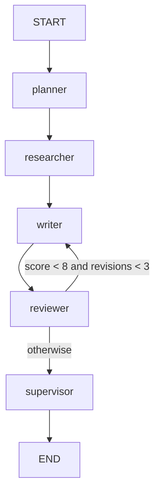

# AI Crew

A LangGraph pipeline that turns a topic into a reviewed blog post, using a local
OpenAI-compatible model (llama-server on `localhost:8080`) and Tavily search.



The supervisor saves the final draft to `data/<topic-slug>.md`.

## Run

```sh
uv venv && uv pip install -r requirements.txt
echo "TAVILY_API_KEY=..." > .env
python multiagent.py
```

Test: `python test_tools.py`
